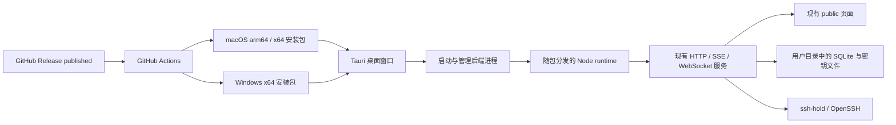

# 桌面端打包与 GitHub Release 方案

## 推荐结论

采用 **Tauri 2 桌面壳 + 独立 Node.js 后端 + 随包分发的 Node runtime**。
保留现有 `public/`、`src/`、SQLite、WebSocket 和 `node-pty`，先交付
macOS Apple Silicon、macOS Intel 和 Windows x64 三类安装包。

参考项目：`../skills-manager-main`。复用其 Tauri、平台构建矩阵、版本同步、
签名与产物验证思路，不复制其应用标识、更新公钥、证书、发布地址或 Rust 业务层。

Tauri 工程、Node 资源准备、WSL2 启动器与 GitHub 构建工作流已加入仓库。
实际构建命令、发布步骤和验证边界见 [DESKTOP.md](DESKTOP.md)。
Windows WSL2 端到端仍需真实 Windows 环境验证，不能以成功打包代替运行验证。

## 现有代码的约束

| 现状 | 对打包的影响 |
| --- | --- |
| `src/server.js` 使用 `node:sqlite` | 安装包携带固定版本 Node 24 LTS，不依赖用户安装 Node |
| `src/terminal-server.js` 使用 `node-pty` | 每个平台、架构独立安装或编译原生模块；不能跨平台复制 `node_modules` |
| ssh-hold 依赖 Bash、OpenSSH ControlMaster、Unix 套接字 | Windows 不能靠增加 `.exe` 安装包直接获得本地 SSH 能力 |
| 数据默认写到仓库 `data/` | 桌面版必须改用用户数据目录，禁止向签名应用包写数据 |
| Web 服务支持修改端口和重启 | 桌面壳必须跟踪后端新地址，不能固定加载 `8787` |
| 已有 Web 登录、同源检查、终端授权 | 桌面封装保留这些保护，不对渲染页开放任意 shell 执行权限 |
| Agent 检测使用运行服务用户的主目录 | Windows 如使用 WSL 后端，必须区分 Windows 与 WSL 的 Agent/skill 路径 |

## 桌面结构



Tauri 负责单实例、窗口、菜单、外部链接、后端生命周期及安装包；Node 负责现有业务。
首期不把 Node 程序转换成单文件可执行程序，避免 `node:sqlite`、动态资源和原生模块的兼容问题。

实现结构（以仓库实际文件为准）：

```text
src-tauri/
  Cargo.toml
  Cargo.lock
  tauri.conf.json
  src/main.rs
  icons/
desktop/
  backend-entry.mjs           后端生命周期入口
  start-wsl.sh                WSL2 后端部署与启动
  loading/                   启动中与启动失败页面
scripts/
  prepare-desktop.mjs         在当前平台准备 runtime、生产依赖、资源和校验信息
  verify-desktop.mjs          校验 runtime、启动后端并验证 SQLite、PTY、资源
  prepare-release.mjs         同步 Node、Cargo、Tauri 版本
.github/workflows/
  desktop-check.yml           PR 构建验证，不上传 Release
  desktop-release.yml         Release 发布和手动构建
```

`build/icons/default/` 的 ICO、ICNS、PNG 可直接复用。构建缓存、准备后的依赖和安装包
分别放在忽略目录，仓库只保存源码、锁文件、配置及必要图标。

## Windows 运行方式

**已于 2026-11-01 确定使用 WSL2 后端。** Windows 使用原生 Tauri 桌面窗口，
Node、ssh-hold、OpenSSH 和 PTY 在 WSL2 Linux 发行版中运行。
下表保留其他方式的比较，实施按 WSL2 方案推进：

| 方式 | SSH 功能 | 用户依赖 | 工作范围 |
| --- | --- | --- | --- |
| WSL2 后端，已选定 | 复用现有 ssh-hold、ControlMaster、PTY | 已初始化的 WSL2 Linux 发行版及 SSH 依赖 | 增加发行版检测、后端部署与生命周期管理 |
| 连接已有 Web 服务 | 在现有 macOS/Linux 服务上执行 | 可访问的既有服务地址 | 增加连接配置，不能称为 Windows 本机 SSH 工具 |
| 原生 Windows SSH 引擎 | 需重新定义连接保持、跳板和终端实现 | Windows OpenSSH 等 | 独立的 SSH 后端适配项目，不能只做打包配置 |

### WSL2 实施要求

- Windows 安装包本身是原生 Tauri/NSIS，SSH 后端运行在 WSL2。
- 首次启动检查 WSL2 和发行版；缺失时说明具体缺项，不自动修改系统组件或安装发行版。
- Linux runtime 和 Linux `node-pty` 必须由 Linux runner 构建，再作为资源加入 Windows 安装包。
- runtime 解包到 WSL 用户的 Linux 文件系统；Unix 套接字保存在 Linux 家目录，不放到 `/mnt/c`。
- 发行版与 Linux 用户固定后再确定数据目录，升级不能改变数据归属。
- Windows 通过 localhost 转发连接后端；启动检测必须验证实际启动的服务，避免误连已有端口。
- 需要验证默认 WSL 网络模式、localhost 转发、路径含空格及中文用户名。
- **Agent 管理需要额外适配**：在 Windows 侧检测和安装 Windows Agent 的 skill，
  WSL Agent 则使用 Linux 路径；界面必须区分所属环境。不能把 WSL 的检测结果当作 Windows 安装状态。
- 先做干净 Windows 机器端到端验证，再把 Windows 安装包标记为可发布。

## 后端启动与退出

1. 桌面壳取得单实例锁，初始化日志与用户数据目录。
2. 校验 runtime、资源清单与原生模块架构；启动随包 Node，而不是 PATH 中的 Node。
3. 强制后端只监听 `127.0.0.1`；首次启动请求系统分配端口，后续可使用已保存设置。
4. 后端通过受控进程通信报告实际端口及本次启动标识；桌面壳等待健康检测通过后展示主窗口。
5. 页面沿用现有登录；仅对应用自身加载的页面授予最小 Tauri 能力。
6. 浏览器外链使用系统浏览器。拒绝向外部页面暴露 IPC；不允许页面提交任意执行命令。
7. 设置页修改服务端口时，桌面壳接收新的实际地址并更新窗口导航限制。
8. 应用退出关闭 Web 终端和自身后端，不主动执行 `ssh-hold stop`，保留用户的 SSH 主通道。
9. 后端异常退出显示重试与日志位置；启动失败必须在超时后明确报错，不能一直停留在空白窗口。

应用资源只读。macOS 数据放在 `~/Library/Application Support/SSH Hold Deck/`；
Windows 桌面配置放在 `%APPDATA%/SSH Hold Deck/`。WSL 后端数据库则放在选定 Linux
用户的数据目录，和 Windows 窗口配置分开。现有加密数据不能直接跨用户复制后假定仍可解密。

## 发布触发方式

主入口采用 GitHub 的 **`release: published`** 事件：在 GitHub 创建并发布一个带版本标签的
Release 后，流水线构建安装包并追加到该 Release，不再创建第二个 Release。
发布 prerelease 也触发构建；只保存 draft 不触发，正式点击发布后触发。

同时提供 `workflow_dispatch`，输入既有 tag。手动运行默认只上传 Actions artifacts，
用于发布前验证；显式启用上传时才把安装包追加到对应 Release。

工作流触发配置示意，实施时与构建脚本一起落地：

```yaml
on:
  release:
    types: [published]
  workflow_dispatch:
    inputs:
      tag:
        description: Existing version tag, for example v0.2.0
        required: true
        type: string
      upload_to_release:
        description: Upload verified installers to the existing release
        default: false
        type: boolean

permissions:
  contents: read

concurrency:
  group: desktop-release-${{ github.event.release.tag_name || inputs.tag }}
  cancel-in-progress: false
```

仓库地址使用工作流的 `github.repository`，当前 remote 为 `jacobs-256/ssh-hold-deck`，
不引用参考项目的仓库。标签通过环境变量传给脚本，不直接拼接为 shell 命令。
准备发布脚本如使用默认 `GITHUB_TOKEN` 推送 tag，不能假定它会再触发另一个工作流；
自动串联应采用可复用 workflow 或显式 dispatch。

## GitHub Actions 构建步骤

| 阶段 | 行为与验收 |
| --- | --- |
| 验证发布版本 | Checkout 对应 tag，要求其与 `package.json`、`Cargo.toml`、Tauri 配置一致；错误立即停止 |
| 运行测试 | 执行现有 Node 测试；增加桌面启动、退出、端口切换及资源隔离测试 |
| 准备 Linux 后端 | 仅 WSL 方案需要；在 Ubuntu x64 构建 Linux runtime/PTY 资源，供 Windows job 下载 |
| macOS arm64 | 原生 ARM macOS runner，生成 Apple Silicon `.dmg` 和 `.app` 压缩包 |
| macOS x64 | 原生 Intel macOS runner，生成 Intel `.dmg` 和 `.app` 压缩包 |
| Windows x64 | Windows x64 runner，生成 NSIS `.exe` 安装包 |
| 平台验证 | 检查运行时版本、平台架构、SQLite、PTY、图标、页面资源、启动与退出；禁止携带开发数据 |
| 签名验证 | 如开启签名，验证签名及公证结果；签名失败不能静默降级为未签名包 |
| 收集产物 | 各 job 上传唯一命名的 Actions artifact；矩阵全部通过后统一收集 |
| 上传 Release | 单独 publish job 使用 `contents: write`，上传安装包和 SHA-256 清单 |

每个构建 job 设置超时；固定 Action commit SHA，固定 Node runtime 版本和 Rust/Tauri 依赖。
从 Node 官方获取 runtime 时验证校验和，再记录版本与架构；生产依赖由锁文件安装。
原生模块应使用与随包 Node 相同的版本/ABI 构建，并在打包前实际加载验证。

不使用“某个平台先完成就立即上传”的方式；任一必要平台失败，都不上传新的整批产物。
由于 `release: published` 时 Release 已公开，构建期间它可能暂时没有安装包，这是该触发方式
的正常结果。需要“安装包齐全后再公开”时，应另行采用手动运行后发布 draft 的流程。

## 产物命名

以 `v0.2.0` 为例：

```text
SSH-Hold-Deck_0.2.0_macos_arm64.dmg
SSH-Hold-Deck_0.2.0_macos_x64.dmg
SSH-Hold-Deck_0.2.0_windows_x64_setup.exe
SHA256SUMS.txt
```

macOS 应用压缩包可作为额外便携产物。首期不承诺应用内自动更新；以后如增加 Tauri updater，
再生成本项目自己的签名密钥、公钥及 `latest.json`，不能使用参考项目的更新密钥。

## 签名配置

- 首次验证可输出明确标注的未签名测试包；macOS Gatekeeper 和 Windows SmartScreen 可能拦截。
- 正式面向其他用户分发，建议 macOS Developer ID 签名并公证；Windows 使用代码签名证书或受支持的签名服务。
- 签名模式需要显式配置；开启后必须检查全部必需 Secrets，缺失则失败。
- macOS 的证书、密码、签名身份和 App Store Connect 公证凭据保存在当前仓库 Secrets。
- Windows 签名凭据按选定的服务配置，不把证书、私钥写进源码、日志或产物。
- 公证设置有限等待时间，构建后验证实际分发包内应用的签名和公证票据。

## 实施顺序与完成标准

1. Windows 已确定采用 WSL2；发布签名要求仍需在实施时配置。先以现有 `0.2.0` 为开发版本，不自动发布。
2. 完成 macOS Tauri 壳、Node runtime 准备、独立用户数据目录和退出清理，实际启动验证。
3. 完成 Windows WSL2 后端适配及 Windows/WSL Agent 路径处理，在干净 Windows 环境实测。
4. 接入版本同步、macOS/Windows 平台矩阵、资源校验及 Release 上传。
5. 手动 workflow_dispatch 构建一轮，仅下载 artifacts 检查安装、启动、升级保留数据、终端与卸载。
6. 发布测试 prerelease，验证 `release: published` 自动构建并追加安装包和校验清单。

完成标准是安装包在目标机器上无需开发工具即可启动，并且 SSH、终端、Agent skill 管理、
端口修改、应用退出与升级数据保留均通过验证；仅成功生成安装包不算完成跨平台支持。
